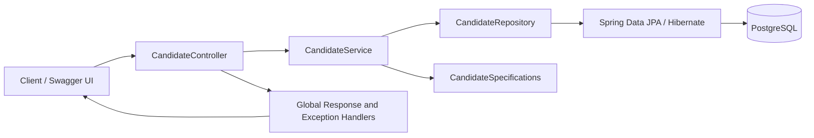
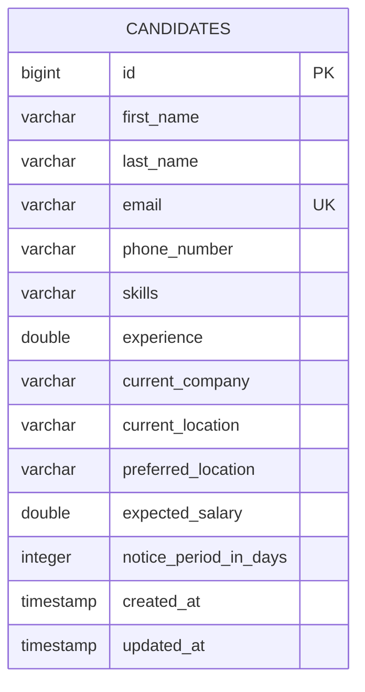

# Candidate Management System
## Technical Design Document

## 1. Project Overview

The Candidate Management System is a RESTful backend application for managing recruitment candidate records. It supports candidate creation, retrieval, full and partial updates, deletion, and filtering across candidate attributes.

### Key capabilities

- Create and maintain candidate profiles.
- Retrieve a candidate by ID or retrieve a candidate collection.
- Search using optional candidate attributes such as name, email, skills, location, experience, salary, and notice period.
- Validate request data and return consistent error responses.
- Persist candidate records in PostgreSQL.
- Explore and test APIs through Swagger UI / OpenAPI.

The current implementation is a backend-only application. It does not include a frontend, authentication, authorization, recruiter roles, job associations, or a recruitment application workflow.

## 2. Technology Stack

| Technology | Version / dependency | Purpose |
|---|---|---|
| Java | 21 | Application language and runtime |
| Spring Boot | 3.5.7 | Application framework and configuration |
| Maven | Wrapper configured for 3.9.11 | Build and dependency management |
| Spring Web MVC | Spring Boot managed | REST endpoints and HTTP handling |
| Spring Data JPA / Hibernate | Spring Boot managed | ORM and database access |
| PostgreSQL | JDBC driver configured | Relational database |
| Jakarta Bean Validation | `spring-boot-starter-validation` | Request validation |
| Lombok | Project dependency | Boilerplate reduction |
| ModelMapper | 3.2.0 | Entity and DTO mapping |
| Springdoc OpenAPI | 2.8.14 | OpenAPI documentation and Swagger UI |
| Flyway | Core and PostgreSQL support dependencies declared | Migration capability; migration scripts are not currently configured |
| JUnit 5 | `spring-boot-starter-test` | Automated testing |
| Mockito | `spring-boot-starter-test` | Mocking dependencies in tests |
| Spring MockMvc | Spring test dependencies | Controller testing |
| Testcontainers PostgreSQL | Test dependency declared | Available for database integration testing; no Testcontainers test is currently included |
| Spring Boot DevTools | Runtime dependency | Local development support |

## 3. Application Architecture

The application follows a layered monolithic architecture. Each layer has a defined responsibility, keeping HTTP handling, business logic, persistence, and API models separate.



### Layer responsibilities

- **Controller:** Receives HTTP requests, binds request data, invokes service methods, and returns HTTP responses.
- **Service:** Implements candidate operations, duplicate checks, range validation, dynamic filtering, pagination/sorting behavior, and entity/DTO mapping.
- **Repository:** Uses Spring Data JPA for candidate CRUD and specification-based queries.
- **Specifications:** Builds reusable predicates for optional string and numeric filters.
- **Entity:** Defines the candidate persistence model.
- **DTOs:** Define request, response, search, and partial-update API models.
- **Advice classes:** Standardize successful response wrapping and exception handling.
- **Configuration:** Defines ModelMapper and OpenAPI configuration.

### Request flow

1. A client sends a request to `CandidateController`.
2. Applicable request DTOs are validated.
3. The controller delegates the operation to `CandidateService`.
4. The service performs business checks and calls `CandidateRepository`.
5. Spring Data JPA and Hibernate execute the database operation.
6. PostgreSQL stores or returns the candidate record.
7. ModelMapper converts the entity to a response DTO.
8. Successful responses are wrapped in the application's `ApiResponse<T>` structure.

## 4. Project Structure

```text
candidate-management/
├── pom.xml
├── mvnw
├── mvnw.cmd
├── .mvn/
│   └── wrapper/
├── src/
│   ├── main/
│   │   ├── java/com/recruitcrm/candidate/
│   │   │   ├── CandidateManagementApplication.java
│   │   │   ├── advices/
│   │   │   │   ├── ApiError.java
│   │   │   │   ├── ApiResponse.java
│   │   │   │   ├── GlobalExceptionHandler.java
│   │   │   │   └── GlobalResponseHandler.java
│   │   │   ├── config/
│   │   │   │   ├── AppConfig.java
│   │   │   │   └── OpenApiConfig.java
│   │   │   ├── controllers/
│   │   │   │   └── CandidateController.java
│   │   │   ├── dtos/
│   │   │   │   ├── CandidateRequestDto.java
│   │   │   │   ├── CandidateResponseDto.java
│   │   │   │   ├── CandidatePatchDto.java
│   │   │   │   └── CandidateSearchDto.java
│   │   │   ├── entities/
│   │   │   │   └── Candidate.java
│   │   │   ├── exceptions/
│   │   │   │   ├── ResourceNotFoundException.java
│   │   │   │   ├── CandidateNotFoundException.java
│   │   │   │   ├── BadRequestException.java
│   │   │   │   └── DuplicateCandidateException.java
│   │   │   ├── repositories/
│   │   │   │   ├── CandidateRepository.java
│   │   │   │   └── CandidateSpecifications.java
│   │   │   └── services/
│   │   │       └── CandidateService.java
│   │   └── resources/
│   │       ├── application.properties
│   │       └── data.sql
│   └── test/java/com/recruitcrm/candidate/
│       ├── CandidateManagementApplicationTests.java
│       ├── controllers/CandidateControllerTest.java
│       └── services/CandidateServiceTest.java
```

## 5. Database Design

### Candidate entity

The `Candidate` entity maps to the `candidates` table.

| Field | Java type | Purpose / validation |
|---|---|---|
| `id` | `Long` | Generated primary key |
| `firstName` | `String` | Required; 3–50 characters |
| `lastName` | `String` | Required; 3–50 characters |
| `email` | `String` | Required, valid email, maximum 100 characters; unique constraint |
| `phoneNumber` | `String` | Required; exactly 10 digits |
| `skills` | `String` | Required; 3–500 characters |
| `experience` | `Double` | Required; 0–60 |
| `currentCompany` | `String` | Required; 3–100 characters |
| `currentLocation` | `String` | Required; 3–100 characters |
| `preferredLocation` | `String` | Required; 3–100 characters |
| `expectedSalary` | `Double` | Required; non-negative |
| `noticePeriodInDays` | `Integer` | Required; 0–365 |
| `createdAt` | `LocalDateTime` | Creation timestamp field; automatic lifecycle population is not implemented |
| `updatedAt` | `LocalDateTime` | Updated by the PATCH implementation; automatic lifecycle population for all update paths is not implemented |

Validation is primarily applied through DTO constraints. The entity also declares database indexes and a unique email constraint.

### Keys and indexes

- Primary key: `id`, generated using `GenerationType.IDENTITY`.
- Unique constraint: `uk_candidates_email` on `email`.
- Declared indexes:
  - `idx_candidates_first_name`
  - `idx_candidates_last_name`
  - `idx_candidates_skills`
  - `idx_candidates_experience`
  - `idx_candidates_salary`
  - `idx_candidates_locations` on current and preferred location
  - `idx_candidates_notice_period`

There are currently no entity relationships or foreign-key associations. Candidate records are standalone.

### Entity relationship diagram



### Persistence configuration

The inspected local configuration currently uses:

- PostgreSQL at `jdbc:postgresql://localhost:5432/recruitcrm`.
- Hibernate `ddl-auto=update`.
- SQL seed initialization through `data.sql`.
- Flyway disabled.
- SQL logging enabled.
- Open Session in View not explicitly disabled.

**Persistence behavior:** With `ddl-auto=update`, Hibernate updates the schema as needed without intentionally dropping the existing tables when the application shuts down. Candidate records can therefore remain in the database across normal application restarts. This setting is appropriate for the current local assignment setup, but it is not a substitute for versioned database migrations in a production deployment. Flyway is currently disabled and no migration script was present in the inspected project. Database credentials should be supplied through environment variables or a secret manager rather than committed to source control.

## 6. REST API Design

All endpoints are under `/candidates`. Successful responses are generally wrapped by `GlobalResponseHandler` using `ApiResponse<T>`.

### Endpoint summary

| Method | Endpoint | Description | Expected status codes |
|---|---|---|---|
| POST | `/candidates/create` | Create a candidate | 201, 400, 409 |
| GET | `/candidates/{id}` | Retrieve a candidate by ID | 200, 404 |
| GET | `/candidates/all` | Retrieve candidates with pagination and sorting (`page`, `size`, `sort`) | 200 |
| GET | `/candidates/filter` | Filter candidates with pagination and sorting (`page`, `size`, `sort`) | 200, 400 |
| PUT | `/candidates/{id}` | Update a candidate using the full request DTO | 200, 400, 404, 409 |
| PATCH | `/candidates/{id}` | Partially update supplied candidate fields | 200, 400, 404, 409 |
| DELETE | `/candidates/{id}` | Delete a candidate | 204, 404 |

Both list and filter controller methods expose Spring Data `Pageable` parameters. Clients can provide `page`, `size`, and `sort` query parameters. The default page size is 20, the default sort field is `id`, and the service validates supported sort fields and enforces a maximum page size of 100.

### Create candidate

`POST /candidates/create`

Example request:

```json
{
  "firstName": "Aarav",
  "lastName": "Sharma",
  "email": "aarav.sharma@example.com",
  "phoneNumber": "9876543210",
  "skills": "Java, Spring Boot, PostgreSQL",
  "experience": 3.5,
  "currentCompany": "Example Technologies",
  "currentLocation": "Pune",
  "preferredLocation": "Bangalore",
  "expectedSalary": 900000,
  "noticePeriodInDays": 30
}
```

The request is validated, checked for a duplicate email, mapped to the entity, and saved. A successful request returns HTTP 201.

### Retrieve candidate

`GET /candidates/{id}`

Returns the candidate matching the supplied ID. If no candidate exists, the service throws a candidate-not-found exception and the API returns HTTP 404.

### Retrieve all candidates

`GET /candidates/all`

Returns candidate records as a paginated response. Clients can supply `page`, `size`, and `sort` query parameters through Spring Data `Pageable`.

### Filter candidates

`GET /candidates/filter`

Supported optional query fields:

- `firstName`
- `lastName`
- `email`
- `skills`
- `currentCompany`
- `currentLocation`
- `preferredLocation`
- `experienceMin`
- `experienceMax`
- `salaryMin`
- `salaryMax`
- `noticePeriodMax`

Example:

```text
/candidates/filter?skills=Java&experienceMin=3&experienceMax=8&preferredLocation=Bangalore&page=0&size=20
```

String filters use partial, case-insensitive matching. Numeric filters support minimum and maximum values. Supplied filters are combined using JPA Specification predicates.

### Update candidate

`PUT /candidates/{id}`

Accepts a complete `CandidateRequestDto`, maps the supplied values onto the existing candidate, and saves the updated entity. A missing candidate returns HTTP 404.

### Partially update candidate

`PATCH /candidates/{id}`

Example request:

```json
{
  "experience": 5,
  "currentCompany": "Example Technologies"
}
```

The endpoint accepts a map of fields and values. The service:

1. Rejects an empty request.
2. Rejects fields that are not in the patchable-field whitelist.
3. Maps the supplied values to `CandidatePatchDto`.
4. Applies Bean Validation to the patch DTO.
5. Loads the existing candidate.
6. Converts and applies the supplied values to the entity.
7. Updates `updatedAt`.
8. Saves the entity and returns the response DTO.

This approach supports flexible partial updates, but uses reflection and explicit type conversion. It is less type-safe than direct property assignment or a standard JSON Merge Patch implementation.

### Delete candidate

`DELETE /candidates/{id}`

Deletes the candidate if found and returns HTTP 204 with no response body. If the candidate does not exist, the API returns HTTP 404.

## 7. Business Logic and Filtering

### Candidate creation and duplicate handling

The service checks whether a candidate with the submitted email already exists, using a case-insensitive lookup. If a duplicate is found, it throws `DuplicateCandidateException`, which is mapped to HTTP 409 Conflict. A database unique constraint provides an additional safeguard.

### Candidate update

PUT and PATCH operations check whether the submitted email is already associated with a different candidate before saving the change.

### Dynamic filtering

`CandidateSpecifications` builds reusable predicates for:

- Partial, case-insensitive string matching.
- Minimum and maximum experience.
- Minimum and maximum expected salary.
- Maximum notice period.

Optional filters are combined using `AND` conditions. Range validation rejects a minimum experience greater than its maximum or a minimum salary greater than its maximum.

### Pagination and sorting

The `/all` and `/filter` controller methods accept Spring Data `Pageable` and return paginated results. The service validates the requested sort field and page size (maximum 100). Pagination limits the amount of data returned in each response and supports larger candidate collections.

## 8. Validation and Exception Handling

### Request validation

`CandidateRequestDto` uses Jakarta Bean Validation constraints for:

- Required and non-blank values.
- String length limits.
- Email format.
- Ten-digit phone number.
- Experience between 0 and 60.
- Non-negative expected salary.
- Notice period between 0 and 365 days.

Search DTOs validate numeric filter ranges. PATCH values are converted to `CandidatePatchDto` and validated before being applied.

### Standard response format

Successful responses use the `ApiResponse<T>` structure:

```json
{
  "timestamp": "2026-11-22T12:00:00",
  "data": {},
  "error": null
}
```

Error responses use the same outer structure, with `data` set to `null` and an `error` object containing the status, message, and optional sub-errors.

### Exception mapping

`GlobalExceptionHandler` centralizes exception-to-HTTP-status mapping.

| Exception / condition | HTTP status |
|---|---:|
| Candidate/resource not found | 404 |
| Bad request | 400 |
| Bean validation failure | 400 |
| Binding failure | 400 |
| Constraint violation | 400 |
| Malformed JSON | 400 |
| Missing request parameter | 400 |
| Parameter type mismatch | 400 |
| Data integrity / duplicate conflict | 409 |
| Unexpected exception | 500 |

Custom exceptions include `CandidateNotFoundException`, `ResourceNotFoundException`, `BadRequestException`, and `DuplicateCandidateException`.

## 9. Testing Strategy

The project uses JUnit 5, Mockito, Spring Boot test support, and Spring MockMvc.

### Test coverage areas

- Spring application context loading.
- Candidate creation and repository interaction.
- Candidate retrieval and not-found behavior.
- Candidate update and deletion.
- Empty and unknown PATCH field handling.
- Partial update behavior.
- Invalid experience and salary ranges.
- Multi-filter search behavior.
- Controller request handling and HTTP status codes for create, retrieve, update, patch, delete, and search.

Service tests use mocked dependencies. Controller tests use a standalone MockMvc setup.

### Recorded test execution

The supplied project documentation records a Maven test run on November 22, 2026, with:

- Tests: 26
- Failures: 0
- Errors: 0
- Result: `BUILD SUCCESS`

Run the test suite again against the exact source being submitted to confirm that this result remains current. No coverage percentage, load-test result, or completed Testcontainers integration suite is claimed.

## 10. Security and Performance Considerations

### Implemented safeguards

- Bean Validation on applicable request DTOs.
- PATCH field whitelist to prevent updates to arbitrary entity fields.
- Application-level duplicate email checks and a database unique constraint.
- Pageable query support and service-level page-size/sort-field validation.
- Database indexes on selected candidate fields.

### Current security limitations

- Authentication and authorization are not implemented.
- There are no recruiter roles, ownership checks, or role-based access rules.
- Request rate limiting is not configured.
- API audit history and request correlation IDs are not implemented.
- SQL logging is enabled in the inspected local configuration.
- Database credentials and environment-specific settings require secure external configuration.
- Swagger is configured for development; production exposure should be reviewed before deployment.

This application should not be exposed as a production recruitment system until appropriate authentication, authorization, transport security, secret management, and operational controls are added.

### Performance considerations

The current implementation uses PostgreSQL indexes and pagination. Query plans and index effectiveness should be checked against realistic data volumes and search patterns. Substring searches may require additional PostgreSQL text-search or trigram indexing if the dataset grows substantially.

## 11. Scalability and Future Improvements

The following are possible future enhancements and are not part of the current implementation:

- **Database optimization:** Review query plans, add composite indexes based on common filter combinations, and consider keyset pagination for deep result sets.
- **Caching:** Add Redis for frequently accessed candidate records or repeated searches, with invalidation on create, update, and delete.
- **Advanced search:** Consider PostgreSQL full-text/trigram search or Elasticsearch if fuzzy matching, ranking, or faceted search becomes necessary.
- **Horizontal scaling:** Run multiple stateless application instances behind a load balancer.
- **Asynchronous processing:** Introduce Kafka or another message broker if candidate imports, notifications, search indexing, or audit events require asynchronous processing.
- **Observability:** Add Spring Boot Actuator, metrics, centralized structured logs, distributed tracing, and alerting.
- **Database migrations:** Add Flyway migration scripts and use controlled schema changes across environments.
- **Security:** Add Spring Security with JWT/OAuth2 or an organizational identity provider, plus role-based access control.

These enhancements should be introduced when justified by actual product requirements and traffic rather than added prematurely.

## 12. Setup and Execution

### Prerequisites

- Java 21.
- PostgreSQL.
- Maven, or the Maven Wrapper included in the repository.
- A PostgreSQL database named `recruitcrm`.

### Database setup

Create the local database:

```sql
CREATE DATABASE recruitcrm;
```

Configure the datasource URL, username, and password in `application.properties` or through environment variables. Do not commit real database credentials.

Example PowerShell environment variables:

```powershell
$env:SPRING_DATASOURCE_URL="jdbc:postgresql://localhost:5432/recruitcrm"
$env:SPRING_DATASOURCE_USERNAME="your_database_user"
$env:SPRING_DATASOURCE_PASSWORD="your_database_password"
```

### Build and test

From the project root on Windows:

```powershell
.\mvnw.cmd clean test
```

### Run the application

```powershell
.\mvnw.cmd spring-boot:run
```

Alternatively, package and run the JAR:

```powershell
.\mvnw.cmd clean package -DskipTests
java -jar .\target\candidate-management-0.0.1-SNAPSHOT.jar
```

### API documentation

With the application running, open:

- Swagger UI: `http://localhost:8080/swagger-ui.html`
- OpenAPI document: `http://localhost:8080/api-docs`

**Persistence note:** The current local configuration uses `ddl-auto=update`, so the schema is not intentionally dropped when the application shuts down and candidate data can persist across restarts. Flyway is currently disabled and migration scripts are not included; add versioned migrations before using this application in a production environment.

## 13. Design Decisions and Trade-offs

| Decision | Rationale | Trade-off |
|---|---|---|
| Layered monolithic architecture | Fits the scope and keeps the application straightforward to develop and run. | Less independently deployable than a microservices architecture, which is not needed for this scope. |
| Separate DTOs and entities | Keeps API contracts independent from the persistence model. | Requires mapping between DTOs and entities. |
| JPA Specifications | Supports combinations of optional filters without creating many repository methods. | Dynamic query behavior can be harder to inspect than a small set of fixed queries. |
| ModelMapper | Reduces repetitive mapping code. | Runtime convention-based mapping is less explicit than hand-written or compile-time mapping. |
| Map-based PATCH | Allows clients to submit only the fields they want to change. | Reflection and conversion logic reduce type safety and maintainability. |
| Global response wrapper | Provides a consistent response structure. | Requires special handling if future APIs return files, streams, or response types that should not be wrapped. |
| Database unique email constraint | Protects data integrity at the database level. | Email case normalization and database constraint behavior should be aligned for fully case-insensitive uniqueness. |

## 14. Known Limitations

- The current local database configuration uses `ddl-auto=update`. This supports schema updates during local development, but a versioned migration strategy is recommended for production.
- Flyway dependencies are present, but Flyway is disabled and no migration scripts were found in the inspected project.
- Authentication and authorization are not implemented.
- Automatic lifecycle population of `createdAt` and `updatedAt` is incomplete; PATCH explicitly updates `updatedAt`.
- PATCH uses a field map, reflection, and manual type conversion.
- Skills are stored as a text field rather than normalized skill records.
- Candidate records have no relationships to recruiters, jobs, or applications.
- Redis, Elasticsearch, and Kafka are not implemented.
- Actuator metrics, centralized logging, tracing, audit history, and soft deletion are not implemented.
- Testcontainers is declared as a dependency, but no Testcontainers integration test was found.
- No load/performance test or code-coverage report is included.

## 15. Verification Summary

The inspected project documentation identifies the following implemented capabilities:

- Java 21 and Spring Boot 3.5.7.
- PostgreSQL with Spring Data JPA/Hibernate.
- Candidate CRUD and partial update operations.
- Dynamic filtering using JPA Specifications.
- DTO validation and centralized exception handling.
- Swagger/OpenAPI configuration.
- Database indexes and a unique email constraint.
- Unit and controller tests, with a recorded result of 26 tests passing.

The test result should be reconfirmed by running the Maven test command against the final submitted source. Database persistence should also be checked by creating a candidate, restarting the application, and confirming that the record remains available.
